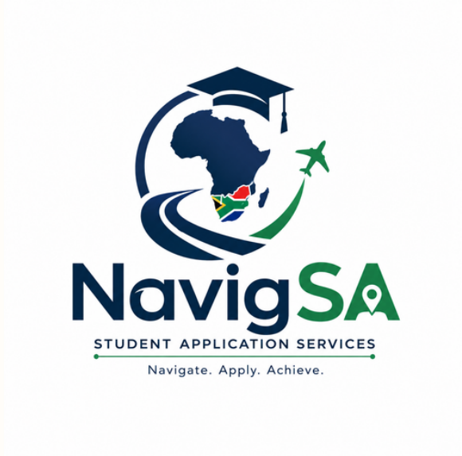

# Nolwazi Zulu

📍 Cape Town, Western Cape  
📞 071 471 8241  
📧 220118876@mycput.ac.za  

---

## Objective

I am a hardworking and creative individual who is open to learning new things and gaining experience. I work well with people, have strong communication skills, and I am passionate about making things happen.

---

## Education

**Diploma in ICT: Application Development**  
Cape Peninsula University of Technology (CPUT)  
2024 – Present  

**Diploma in Product Design**  
Cape Peninsula University of Technology (CPUT)  
2020 – 2023  

**High School**  
Sans Souci Girls’ High School  
2014 – 2019  

---

## Technical Skills

- HTML
- CSS
- Java
- JavaScript
- C++
- Agile / Scrum (team charters, user stories, product and sprint backlogs, Trello, agile logbooks)

---

## Work Experience

**Assistant Mark Checker**  
Western Cape Education Department  
December 2025  

**Lab Supervisor**  
CPUT – E-Learning Centre  
March 2023 – Present  

**Assistant Mark Checker**  
Western Cape Education Department  
December 2023  

**Lab Assistant**  
CPUT – E-Learning Centre  
March 2022 – March 2023  

---

## Projects

### RFID Card Reader for Shuttle Systems

Designed a system to improve access to campus shuttles by reducing congestion and increasing safety using RFID technology.

### Student Residence System for CPUT

Developed a system that helps students find available accommodation by showing available spaces, residence capacity, and intake information.

---

### NavigSA – Student Navigation Platform

  

<em>Navigate. Apply. Achieve.</em>

**Module:** Project Presentation 3 (PRP370S / PRP371S / PRP372S) – Diploma in ICT, CPUT  
**My role:** Team Leader / Presenter  
**Team:** Witcha Francisco (Editor), Tanatswa Mabhodha (Researcher), Marc Kabala (Designer), Nolwazi Zulu (Team Leader / Presenter)  
**Project period:** 14 July – 30 October 2026

#### About the project

NavigSA is a multilingual platform that guides international students into South African universities. Students from countries such as Zimbabwe, the DRC, Angola, Mozambique and Ethiopia face a multi-step entry process (SAQA evaluation, university applications, study visa and housing) in English, often with confusing documents and no local guidance. Our research and interviews with eight students showed an average pain level of 4.0 out of 5, six of the eight said they would pay for help, and local agents charge between R400 and R2,200.

NavigSA responds with guides in French, Portuguese and English, numbered step-by-step roadmaps, expert review before submission, transparent flat-rate pricing, and tracking with proactive deadline reminders. The completed website is deployed on Vercel and uses Supabase.

As Team Leader and Presenter I coordinated the team, tracked tasks on our Trello board, led the business pitch presentation, and kept our Agile documentation moving from sprint to sprint.

#### Portfolio map (how this section follows the Collect – Select – Reflect – Connect approach)

| # | Rubric criterion | Evidence | Reflection |
|---|---|---|---|
| 1 | Agile Team Charter | [Evidence](#1-agile-team-charter) | [Reflection](#reflection-agile-team-charter) |
| 2 | User Stories and Tasks | [Evidence](#2-user-stories-and-tasks) | [Reflection](#reflection-user-stories-and-tasks) |
| 3 | Product Backlog | [Evidence](#3-product-backlog) | [Reflection](#reflection-product-backlog) |
| 4 | Sprint Backlog | [Evidence](#4-sprint-backlog) | [Reflection](#reflection-sprint-backlog) |
| 5 | Agile Logbook | [Evidence](#5-agile-logbook) | [Reflection](#reflection-agile-logbook) |

---

## 1. Agile Team Charter

### Evidence

An Agile team charter is a living, co-created social contract that defines a team's shared purpose, core values, working agreements and boundaries. Each of us wrote an individual charter for our role. Mine is the **Team Leader / Presenter** charter, which sets out my responsibilities (coordinating the team, running meetings and daily check-ins, allocating tasks and tracking them on Trello, identifying blockers early, and presenting NavigSA), our shared values (collaboration, respect, transparency, accountability, excellence), our communication plan (WhatsApp, Microsoft Teams, weekly in-person meetings, Google Docs, Trello) and my SMART goals and milestones.

| Document | Access |
|---|---|
| NavigSA Team Charter (all four individual charters, including my Team Leader charter and reflection) | [View PDF](DOC-20261027-WA0096.pdf) |
| NavigSA Pitch Presentation (our team, roles and the project the charter supports) | [View PDF](DOC-20261027-WA0010.pdf) |

### Reflection: Agile Team Charter

**Purpose of the charter.** Our team charter set out who we are, what each person is responsible for, how we communicate, and the goals we are working towards. Having this agreed early meant we were not guessing about roles: Witcha edited and integrated our work, Tanatswa researched, Marc designed, and I led and presented. As Team Leader, my job was to make sure the charter became how we actually worked, not just a document we submitted.

**What worked well.** Applying Scrum gave the charter structure. We moved our work onto a Trello board, rewrote the Product Backlog as customer-focused user stories after our lecturer's feedback, planned Sprint 1, and recorded daily standups. This kept everyone's tasks visible and made it easy to see what was done and what was blocked. Our agreed communication channels also helped: WhatsApp for quick updates, meetings for decisions, and shared documents for collaboration. Our interviews with eight students gave the team real evidence to build on, which kept our values of transparency and excellence practical rather than abstract.

**Challenges.** Our biggest recurring challenge was dependency. In our standups, the same impediment kept appearing: we were waiting for confirmation from team members before work could be finalised. As leader, I learned that I must follow up earlier and make deadlines explicit for each person rather than assuming everyone has the same picture. I also had to balance two jobs: coordinating the team while preparing to present. Our short pitch format meant I needed to understand every part of the project well enough to explain it in a few minutes.

**What I learned.** Leadership in an agile team is about facilitating, not controlling: removing blockers, keeping communication open, and creating space for feedback. Agile principles only work when the team lives them. Feedback from our lecturer improved our backlog, and the same habit of drafting, reviewing and improving made our work stronger. Accountability became real once tasks had names and statuses on the board.

**What I would do differently.**
- Review the charter with the team at the start of each sprint, and update it when our needs change.
- Agree on a specific due date for every task, so waiting for confirmation does not delay the sprint.
- Start rehearsing the presentation earlier, and give every member time to practise.
- Check in more often on how the team is feeling about workload, not only task progress.

**Conclusion.** The charter gave our team a shared foundation, and Scrum gave us a way to work from it. I have grown in confidence as a leader and presenter, and I now see that a strong team depends as much on clear communication and accountability as on individual skill.

---

## 2. User Stories and Tasks

### Evidence

A user story is a short description of a software feature written from the end user's perspective, broken down into tasks. We planned NavigSA on our Trello board using user stories in the format *"As a [role], I want [goal], so that [benefit]"*, written for five kinds of user: the international student, the French- or Portuguese-speaking student, the service provider, the administrator and our project supervisor. Stories were marked High or Medium priority and split into daily sprint cards. The Product Backlog document later added a numbered task list under each story (for example US-01.1, US-01.2).

| Document | Access |
|---|---|
| Reflection: User Stories and Tasks (Trello board review) | [View PDF](Reflection%20-%20User%20Stories%20and%20Tasks.pdf) |
| Product Backlog (user stories with task IDs and owners) | [View PDF](NavigSA_Product_Backlog.pdf) |

### Reflection: User Stories and Tasks

**What we did.** We used our Trello board to plan the NavigSA project through user stories and tasks. On the Trello board we built a Product Backlog of 28 stories and broke them down into 52 daily sprint cards across Sprint Week 1 to Sprint Week 13. Every card has a user story at the top and a short description of the work underneath. We wrote stories for five different kinds of user and marked each backlog story as High or Medium priority so that everyone knew what to build first.

**What went well.** Most of our stories are written from the student's point of view and say clearly why the feature matters, for example: *"As an international student, I want to track my application progress so that I always know what stage my application is in."* The "so that" part kept us thinking about the student instead of only the technology. Splitting big stories into daily cards also worked well. The student dashboard was too large for one day, so we split it across Sprint 33 (build and integrate the dashboard), Sprint 34 (bookings, appointments and notifications) and Sprint 35 (connect it to the backend and test). We did the same with multilingual content: Sprint 46 completed the translations and Sprint 47 checked that they were accurate. We even wrote our testing work as user stories, which reminded us that testing is about the student's experience, not just finding bugs.

**What we struggled with.** Looking back over the board, we can see several things we would do differently:
- **No tasks or acceptance criteria on the cards.** None of our cards had a checklist, so it was not always clear when a card was really finished.
- **One story was too big.** Sprints 29 to 32 all use the same story. The work was actually four technical steps (backend setup, database design, database models and APIs). We should have written it as one story with four tasks.
- **Titles that didn't match the story.** Some cards were copied and the story was changed, but not the title. Sprint 15 is called "Complete the financial planning" but its story is about the brand guide.
- **Stories that are not really user stories.** Items such as the monthly reports were written as "As a project supervisor, I want...". That work was important, but it is a project task rather than a feature for a user.
- **The backlog was not kept up to date.** 21 of the 28 backlog stories are still not ticked complete, even where the sprint work is done. Three stories were never planned into a sprint at all.

**What we learnt.** A user story is only the starting point. To be useful to the team, it also needs clear acceptance criteria that say when it is done, a size that fits in one sprint, and a list of tasks. The Trello board is only good evidence if it is kept accurate. When the titles, statuses and stories don't match, the board stops telling the true story of the project.

**What we will do differently next time.**
- Write two or three acceptance criteria for every story before it goes into a sprint.
- Add the tasks to each card as a Trello checklist, so progress is visible.
- Split stories that are too big into smaller stories instead of repeating the same story across several days.
- Keep project admin, such as reports and presentations, as tasks rather than user stories.
- At the end of each sprint week, tick off finished stories and check that every card's title matches its story.

---

## 3. Product Backlog

### Evidence

Our Product Backlog is the single ordered list of everything the NavigSA team needed to deliver. It holds **36 user stories and 276 tasks**, each task sized at about one working day. It has two parts: **Part A**, the original 15 core work streams with agreed task owners (for example Community and Market Research, Business Concept Definition, Platform Design, System Architecture, Website Development and Testing), and **Part B**, an expanded set of customer-facing and supporting stories (US-16 to US-36) such as View Student Dashboard, Track Application Status, Book NavigSA Service, Submit Reviews, Access Multilingual Content and Protect Student Information. A "Sprint coverage" column links each story to the sprints in which it was worked on. The document also records that the technology stack changed during implementation: the original plan (Spring Boot, React, MySQL, Railway) became a website deployed on Vercel using Supabase.

| Document | Access |
|---|---|
| NavigSA Product Backlog (36 user stories, 276 tasks) | [View PDF](NavigSA_Product_Backlog.pdf) |
| Agile Logbook: 28–31 July (backlog restructuring after lecturer feedback) | [View PDF](_Logbook%20.pdf) |

### Reflection: Product Backlog

**What we did.** The backlog started as a list of work streams drawn from our problem identification research. After we presented our Figma prototype and Product Backlog to our lecturer on 28 July, the feedback was that the items needed to follow Scrum standards. Over the next days we rewrote every item as a customer-focused user story, added detailed subtasks, put the items in priority order, assigned responsibilities and reviewed the order with the team before Sprint 1 planning. The result is the ordered list in the document above. I was responsible for the customer profile, decision maker and persona story task (US02.6) and for presenting the business concept (US04.2), and as Team Leader I was responsible for making sure the backlog matched the assignment requirements and the board.

**What went well.**
- **Feedback changed the work.** Restructuring after our lecturer's feedback made the backlog much clearer. The "As a… I want… so that…" format forced us to name who benefits.
- **Traceability.** Every story has a unique ID and each task carries that ID, and the Sprint coverage column connects the backlog to the Sprint Backlog, so anyone can follow a story from idea to delivery.
- **It behaved like a living document.** When the technology stack changed, we recorded the change in the backlog, and we renumbered Part B so that every ID is unique.
- **Honest ownership in Part A.** Each Part A task has a named owner, which made accountability visible.

**What was difficult.**
- **The backlog was bigger than we could deliver.** Of the 36 stories, 23 were never scheduled in the Sprint Backlog, including many Part B stories such as the dashboard, booking and notifications. Our 50 one-day sprints concentrated on the core build, so the backlog describes more than we delivered.
- **Part B has no owners.** Unlike Part A, the expanded stories list tasks without a named person, which made them easier to leave unscheduled.
- **Some stories were still too large.** Stories such as Use a Reliable Platform (16 tasks) and Protect Student Information (12 tasks) are too big for one sprint, which is the same lesson our Trello reflection recorded.
- **Dependency on confirmation.** In the 28–31 July standups, priorities could not be finalised until every team member confirmed them, which delayed Sprint 1 planning.

**What I learned.** A Product Backlog is a prioritisation tool, not a wish list. Ordering matters because the team only has a limited number of sprints, and a story that is never scheduled needs an explicit decision to drop it or move it to a later release. I also learned that a backlog earns trust only when it is updated as the project changes.

**What I would do differently.**
- Decide at the start which stories belong to the first release and label the rest as "later", instead of leaving them silently unscheduled.
- Add acceptance criteria and a named owner to every story, including Part B.
- Split any story over about eight tasks.
- Hold a short backlog refinement session once a week, and tick off finished stories immediately.

---

## 4. Sprint Backlog

### Evidence

Our Sprint Backlog is a chronological record of **50 sprints** from 14 July to 7 October 2026 (Tuesday to Friday, 13 weeks). Each sprint is one working day, is linked to a user story that acts as the sprint goal, and records its tasks, the members responsible, its status and its labels (User Story, Sprint, Day). All 50 sprints are marked completed. The document includes a traceability table showing which sprints delivered each of the 13 user stories worked on, from business concept definition in Week 1, through research, UI/UX design, system architecture and the backend and frontend build, to testing and deployment of the live website on Vercel.

| Document | Access |
|---|---|
| NavigSA Sprint Backlog (50 sprints) | [View PDF](NavigSA_Sprint_Backlog.pdf) |

### Reflection: Sprint Backlog

**What we did.** We turned the ordered Product Backlog into daily sprints. Each day had one user story as its goal and a small set of tasks. Week 1 covered the business concept and our first presentation (Sprint 3, which I led), Weeks 2 to 4 covered research, design and the Brand Guide, Weeks 5 to 7 covered architecture and the backend, Weeks 8 to 11 covered the frontend and testing, and Weeks 11 to 13 covered deployment and the monthly report. Sprint 38 included presenting the backend to our supervisor, who was happy with it.

**What went well.**
- **A daily rhythm.** One-day sprints gave us a visible pace and made it easy to see what was finished each day.
- **Clear goals.** Linking every sprint to one user story meant each day had a single purpose, and the traceability table shows how the stories moved through the project.
- **Feedback loops.** Presenting the prototype (Sprint 13) and the backend (Sprint 38) gave us real feedback at the right moments.
- **Delivery.** All 50 sprints were completed and the project ended with a working, deployed website.

**What was difficult.**
- **Work was concentrated on one person.** Marc is the named member on most of the development sprints (Sprints 17 to 25 and 28 to 45), which created a dependency risk and meant the rest of the team's work was mostly research, design, documentation and presentation. As Team Leader, I should have looked at the spread of work earlier.
- **Records were completed afterwards.** The Sprint Backlog states that, for the middle development sprints, individual completion dates were not separately confirmed and the tasks were summarised from the agreed backlog and the completed project. That makes this record less reliable than one written day by day.
- **Records did not always line up.** Sprint numbers and dates in the Sprint Backlog do not always match what our logbooks and Trello board recorded for the same week, because we kept them in different documents.
- **Not enough Scrum events.** We recorded sprint planning and tasks, but we did not record a sprint review or retrospective for each sprint, and Sprint 49 has no user story attached.
- **Unscheduled stories.** 23 of the 36 backlog stories never entered a sprint.

**What I learned.** A sprint backlog is only useful if it is written while the sprint happens, and if the load is shared realistically. I also learned that one-day sprints are really a daily task list; real sprints are longer, have a sprint goal, a review and a retrospective, and give the team space to adapt.

**What I would do differently.**
- Plan longer sprints (one or two weeks) with a clear sprint goal and a short review and retrospective at the end of each.
- Spread tasks more evenly and check workload with each member during planning.
- Update the Sprint Backlog at the end of each day so that it, the logbook and Trello always match.
- Move unfinished or unplanned stories explicitly to the next sprint or to a "later" list.

---

## 5. Agile Logbook

### Evidence

An agile logbook records daily stand-ups, sprint plans and retrospective notes. Ours follows the Scrum format. Each weekly logbook has a **Task Board** (Product Backlog, In Progress, Completed), a **Walkthrough** answering four questions (What do we need to do to advance this work? Is anyone working on anything not on the board? What do we need to finish as a team? Are there any bottlenecks or blockers?) and a **daily logbook** answering the three stand-up questions (What did I complete? What am I planning to complete? What are my impediments?).

| Logbook | Period | Highlights |
|---|---|---|
| [Agile Logbook: 14–17 July](NavigSA_Agile_Logbook_filled%20copy.pdf) | Week 1 | Planned the presentation, rehearsed, presented NavigSA to our lecturer, held a sprint review and updated the project plan |
| [Agile Logbook: 21–24 July](NavigSA%20Agile%20Logbook%2021-24%20July.pdf) | Week 2 | Set up the Trello board, drafted the first Product Backlog items, and worked around two days with no class |
| [Agile Logbook: 28–31 July](_Logbook%20.pdf) | Week 3 | Presented the Figma prototype, restructured the Product Backlog into user stories, completed Sprint 1 planning |
| [Agile Logbook: 4–7 August](NavigSA_Agile_Logbook_4-7_August.pdf) | Week 4 | UI/UX moderation, Agile documentation, Brand Guide, feasibility study and the July report and register |

### Reflection: Agile Logbook

**What we did.** Across the first four weeks we recorded our work in weekly logbooks that mirrored our Trello board. Each day we wrote what we had completed, what we planned next and what was blocking us, and each week we answered the four walkthrough questions. The logbooks cover the main turning points of the early project: our first pitch, the move to a Trello board, the lecturer's feedback on 28 July, Sprint 1 planning on 31 July, and the Brand Guide and feasibility study in early August.

**What went well.**
- **Impediments were visible.** The logbooks recorded real problems honestly, such as no class on 21 and 24 July (the second because of the lecturer's illness), which slowed team discussions, and the repeated need for team confirmation before backlog items could be finalised.
- **They linked to the board.** The walkthrough questions made us check that nobody was working on anything that was not on the board, which kept our Trello board and our logbook consistent.
- **They recorded decisions.** The 28–31 July entries show clearly how feedback turned into action: restructure the backlog, rewrite it as user stories, prioritise, assign, review and plan Sprint 1.
- **The format kept us disciplined.** Answering the same three questions each day built a habit of thinking about progress and blockers instead of only tasks.

**What was difficult.**
- **The same blocker kept returning.** "Waiting for confirmation" appears in several weeks. Recording a blocker is not the same as removing it, and I should have set a deadline and followed up each time.
- **Coverage stops early.** The logbooks we have cover weeks 1 to 4 of a 13-week project, so the later development, testing and deployment stages are documented in the Sprint Backlog but not in daily stand-ups.
- **Different authors and styles.** Different team members completed different weeks, so the level of detail and formatting varied, and several entries simply say "None" for impediments, which tells the reader very little.
- **Record-keeping took effort.** Keeping the logbook, Trello and the other documents consistent needed regular cross-checking, as the 23 July entry notes.

**What I learned.** A logbook only helps if it leads to action. The value is not in writing the entry but in using it, spotting patterns such as repeated impediments and then changing how the team works. I also learned that consistent habits matter more than long entries, and that a shared template and one owner for the weekly logbook would have made our records stronger.

**What I would do differently.**
- Write the logbook daily and keep it going for the full project, not only the early weeks.
- Record the action taken, the owner and a due date next to each impediment.
- Use one agreed template and one person to check each logbook against Trello and the Sprint Backlog.
- Replace "None" with a short note on risks I can see coming.

---

## Connecting the Artefacts: Overall Reflection

These five artefacts are different views of the same Scrum cycle. The **team charter** defined who we were and how we would work. The **user stories and tasks** and the **Product Backlog** described what we would build and in what order. The **Sprint Backlog** recorded when and by whom it was built, and the **Agile Logbook** captured how the work felt day to day, including the problems.

Read together, they show one clear thread: our process was strongest when it was fed by feedback (our lecturer's comments on 28 July, the supervisor's reaction to the backend) and weakest where our records drifted apart or were completed after the fact. Dependency on team confirmation appears in the charter, the logbooks and the backlog; unscheduled stories appear in the backlog and the Sprint Backlog; and each reflection arrives at the same remedy: clear owners, acceptance criteria, dates and records kept up to date.

As Team Leader, the main lesson is that leading an agile team means keeping the artefacts honest and connected: one source of truth, updated as the work happens, and a team that can see its own progress. I will carry this into my next project by setting up the board, backlog and logbook together on day one and reviewing them with the team every week.

---

## Project Documentation

All evidence for NavigSA in one place:

| Document | Access |
|---|---|
| NavigSA Pitch Presentation | [View PDF](DOC-20261027-WA0010.pdf) |
| NavigSA Team Charter | [View PDF](DOC-20261027-WA0096.pdf) |
| Agile Logbook: 14–17 July | [View PDF](NavigSA_Agile_Logbook_filled%20copy.pdf) |
| Agile Logbook: 21–24 July | [View PDF](NavigSA%20Agile%20Logbook%2021-24%20July.pdf) |
| Agile Logbook: 28–31 July | [View PDF](_Logbook%20.pdf) |
| Agile Logbook: 4–7 August | [View PDF](NavigSA_Agile_Logbook_4-7_August.pdf) |
| Product Backlog | [View PDF](NavigSA_Product_Backlog.pdf) |
| Sprint Backlog | [View PDF](NavigSA_Sprint_Backlog.pdf) |
| Reflection: User Stories and Tasks | [View PDF](Reflection%20-%20User%20Stories%20and%20Tasks.pdf) |

---

## Mock Interview

<video width="600" controls src="HnVideoEditor_2026_03_09_222338481 (1) (1) (1).mp4"></video>

---

## References

**Mr. Vusumzi Lolwana**  
*CPUT – E-Learning Centre Coordinator*  
📧 lolwanav@cput.ac.za  
📞 021 460 3977 / 073 627 1995  

**Mr. Radford Wayne Burger**  
*CPUT – ICT Lecturer*  
📧 burgerr@cput.ac.za  
📞 083 722 3501  

---

© 2026 Nolwazi Zulu
